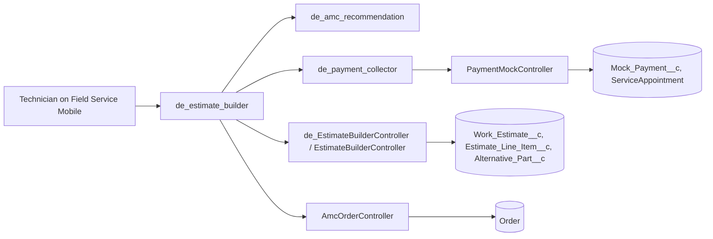

# Field Pay

Field Service mobile components for technicians: a guided damage-estimate wizard, an AMC (annual maintenance contract) upsell sheet and a mock payment collector. Brand in the demo content is the fictional "Aeris Cooling".

## What it does

- **Damage estimate wizard (`de_estimate_builder`)**: a mobile-first, staged journey run from a Work Order or Service Appointment. The technician identifies a part on a split-AC diagram with 10 numbered pointers, picks parts and alternatives (looked up by product code against technician and van inventory), finalises an estimate, shares it (a mock WhatsApp message, no real message is sent), pitches an AMC and collects payment.
- **AMC recommendations (`amcRecommendations`)**: a standalone AMC upsell sheet (global action, record action, record page or home page). It loads context through `AmcOrderController.getContext` and creates AMC orders via `createAmcOrders`.
- **AMC pitch panel (`de_amc_recommendation`)**: the presentational variant embedded by the estimate wizard.
- **Payment collector (`de_payment_collector`)**: a mock payment screen (card, UPI, payment link, cash). No gateway is involved. It records a `Mock_Payment__c` and adds the amount to the Service Appointment through `PaymentMockController`. When embedded in the wizard it takes the finalised estimate total as `bill-amount`.
- **Technician home support (`TechnicianHomeController`)**: Apex for a technician home screen (online probe, performance scorecard, leaderboard, SOS alert). The LWC that used it is not part of this repo.

## Architecture



## Components

| Name | Type | Purpose |
|---|---|---|
| `de_estimate_builder` | LWC | Guided damage-estimate wizard (identify, parts, finalise, share, AMC, pay) |
| `de_amc_recommendation` | LWC | AMC pitch panel used inside the wizard |
| `amcRecommendations` | LWC | Standalone AMC upsell sheet that creates AMC orders |
| `de_payment_collector` | LWC | Mock payment collection |
| `EstimateBuilderController`, `de_EstimateBuilderController` | Apex | Context, inventory, parts lookup, save estimate, mock WhatsApp |
| `AmcOrderController` | Apex | AMC context and order creation |
| `PaymentMockController` | Apex | Records mock payments |
| `TechnicianHomeController` | Apex | Scorecard, leaderboard, SOS |
| `Work_Estimate__c`, `Estimate_Line_Item__c`, `Alternative_Part__c`, `Mock_Payment__c`, `SOS_Alert__c`, `SOS_Setting__mdt` | Objects | Data model |
| `de_aerisAc` | Static resource | Placeholder split-AC identification diagram |
| `de_Estimate_Builder_Access` | Permission set | Access to the estimate Apex |

The `objects/` folder also contains Field Service standard-object fields, field sets and list views (ServiceAppointment, ServiceResource, ServiceTerritory, Order) that the components read.

## Prerequisites

- Salesforce CLI (`sf`)
- An org with Field Service enabled (plus Order and Product2 data) and Field Service Mobile for the technician experience
- Node 18+ only for lint and Jest (`npm install`)

## Setup and deploy

```bash
sf project deploy start --source-dir force-app --target-org <alias>
sf org assign permset --name de_Estimate_Builder_Access --target-org <alias>
```

Then add the components to Lightning record pages, mobile app pages or global actions in Setup.

## Configuration

| Item | Where | What to do |
|---|---|---|
| SOS recipients | `SOS_Setting__mdt` record named `Default` (`Admin_Username__c`, `Dispatcher_Username__c`, `Task_Owner__c`) | Create the record with usernames from your org. With no record, the running user is used |
| Products and parts | `Product2` records | The estimate wizard resolves parts by product code. Load matching products and inventory in your org, or edit the part list in `de_estimate_builder.js` and `de_EstimateBuilderController.cls` |
| Placeholder diagram | `de_aerisAc` static resource | Replace the image with your own, keeping the 10 numbered pointer positions |
| Payments and WhatsApp | none | Both are mocked on purpose. Nothing leaves Salesforce |

## Notes

- Duplicates were merged: the older `estimateBuilder`, `paymentSimulator` and `paymentCollect` were dropped in favour of their `de_` successors. `amcRecommendations` and `de_amc_recommendation` are both kept because they serve different roles (standalone and Apex-backed vs. embedded panel).
- `paymentMethod` was removed because it depended on a B2B Commerce Apex class that is not in this repo.
- The Order field `SDO_OMS_Order_Indicator__c` was removed because its formula contained org-specific document and org IDs.
- Add screenshots under `docs/screenshots/`.

## License

MIT, see [LICENSE](LICENSE).
